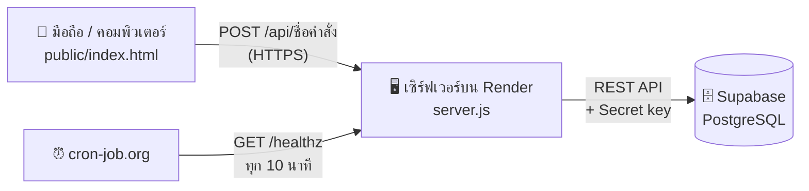

# ระบบลงเวลาปฏิบัติงานออนไลน์ — วิทยาลัยการอาชีพกันตัง

ระบบลงเวลาเข้า–ออกงานผ่านเว็บ/มือถือ พร้อมบันทึกพิกัด GPS ตรวจสอบพื้นที่ (Geofencing) และหน้าผู้ดูแลระบบ

- **Render** — รันเว็บและเซิร์ฟเวอร์ (Node.js + Express)
- **Supabase** — ฐานข้อมูล (PostgreSQL)
- ใช้แพ็กเกจฟรีได้ทั้งคู่ ไม่ใช้ Google Sheet / Apps Script แล้ว

## ไฟล์ในโปรเจกต์

| ไฟล์ | หน้าที่ |
|---|---|
| `server.js` | เซิร์ฟเวอร์ทั้งหมด (ลงเวลา, geofencing, PIN, หน้าแอดมิน, ติดต่อ Supabase) |
| `public/index.html` | หน้าเว็บ — บุคลากรใช้ลงเวลา + หน้าผู้ดูแลระบบสำหรับบทบาท `admin` |
| `package.json`, `package-lock.json` | รายการโปรแกรมที่ต้องติดตั้ง (Render ใช้อัตโนมัติ) |
| `supabase-schema.sql` | สร้างตารางในฐานข้อมูล Supabase (รันครั้งเดียว) |
| `employees-import.csv` | แม่แบบรายชื่อบุคลากรสำหรับนำเข้า Supabase (ชื่อสมมติ — แทนที่ด้วยข้อมูลจริง) |

## ระบบทำงานอย่างไร

### ภาพรวม 3 ชั้น

| ชั้น | อยู่ที่ไหน | ทำอะไร |
|---|---|---|
| **หน้าเว็บ** | `public/index.html` (เปิดในเบราว์เซอร์ของผู้ใช้) | แสดงหน้าจอ อ่านพิกัด GPS แล้วส่งคำสั่งไปเซิร์ฟเวอร์ — **ไม่ได้ติดต่อฐานข้อมูลเอง และไม่มีความลับใด ๆ** |
| **เซิร์ฟเวอร์** | `server.js` รันบน Render | ตรวจ PIN, ตรวจสิทธิ์, คำนวณระยะทาง/มาสาย, อ่าน–เขียนฐานข้อมูล — **ถือ Secret key เพียงที่เดียว** |
| **ฐานข้อมูล** | Supabase | เก็บข้อมูลทั้งหมด และกันการลงเวลาซ้ำด้วยกฎของฐานข้อมูล |

หลักสำคัญ: **ผู้ใช้ไม่สามารถคุยกับฐานข้อมูลได้โดยตรง** ทุกอย่างต้องผ่านเซิร์ฟเวอร์ ซึ่งตรวจความถูกต้องก่อนเสมอ
ผู้ใช้จึงแก้เวลา แก้พิกัด หรือดูข้อมูลคนอื่นจากหน้าเว็บไม่ได้

### เซิร์ฟเวอร์เชื่อมฐานข้อมูลอย่างไร

1. ตอนเริ่มทำงาน `server.js` อ่านค่า `SUPABASE_URL` และ `SUPABASE_KEY` จาก **Environment ของ Render** (ไม่ได้เขียนไว้ในโค้ด)
2. ทุกครั้งที่ต้องใช้ข้อมูล ฟังก์ชัน `sb()` จะส่งคำขอ HTTPS ไปที่ **REST API ของ Supabase**
   `https://<project>.supabase.co/rest/v1/<ชื่อตาราง>` พร้อมแนบ Secret key ใน header `apikey`
   (ใช้ `fetch` ของ Node.js โดยตรง ไม่ต้องติดตั้งไลบรารีของ Supabase)
3. ตัวอย่างคำขอที่ระบบส่งจริง:

   | งาน | คำขอไป Supabase |
   |---|---|
   | หาข้อมูลบุคลากร | `GET employees?emp_id=eq.S001` |
   | บันทึกการลงเวลา | `POST attendance` + ข้อมูล JSON |
   | ตั้ง PIN ใหม่ | `PATCH employees?emp_id=eq.T001` + `{ pin_hash: … }` |
   | ดูการลงเวลาทั้งวัน | `GET attendance?work_date=eq.2026-11-07` |

4. **ความปลอดภัยฝั่งฐานข้อมูล:** ทุกตารางเปิด Row Level Security แต่ไม่มี policy อนุญาตใครเลย
   → คีย์สาธารณะ (anon / publishable) อ่านเขียนไม่ได้แม้แต่แถวเดียว
   → มีเพียง Secret key ซึ่งข้ามกฎนี้ได้ และ Secret key อยู่ใน Render เท่านั้น
5. ค่าตั้งค่า (พิกัด/เวลาทำงาน) ถูกจำไว้ในเซิร์ฟเวอร์ 5 นาทีเพื่อลดการเรียกฐานข้อมูล — แก้จากหน้าแอดมินแล้วมีผลทันที

### ตารางในฐานข้อมูล

| ตาราง | เก็บอะไร | หมายเหตุ |
|---|---|---|
| `employees` | รหัส, ชื่อ, ตำแหน่ง, กลุ่มงาน, บทบาท (`admin`/`user`), สถานะ, `pin_hash` | เก็บ PIN เป็นค่าแฮชเท่านั้น |
| `attendance` | ทุกการลงเวลา: วันที่, เวลา, ประเภท (เข้า/ออก), สถานะ, พิกัด, ระยะห่าง | กฎ `unique (work_date, emp_id, action)` = ลงเวลาเข้า/ออกได้อย่างละครั้งต่อวัน |
| `settings` | พิกัดวิทยาลัย, รัศมี, เวลาเริ่ม–เลิกงาน, โหมดทดสอบ | แก้ได้จากหน้าแอดมิน |
| `logs` | ทุกเหตุการณ์ รวมที่ล้มเหลว | ใช้ตรวจสอบย้อนหลัง |

### ลำดับการทำงานแต่ละเรื่อง

**1. เข้าสู่ระบบ**
1. ผู้ใช้กรอกรหัส + PIN → หน้าเว็บส่ง `POST /api/login`
2. เซิร์ฟเวอร์ดึงข้อมูลบุคลากรจาก `employees` → คำนวณ `SHA-256(รหัส:PIN:PIN_SALT)` แล้วเทียบกับ `pin_hash`
3. ถูกต้อง → ออก **โทเคนรายวัน** (HMAC ของรหัส + วันที่) ให้หน้าเว็บเก็บไว้ในเครื่อง ใช้ได้ถึงเที่ยงคืน (เวลาไทย)
4. ผิด 5 ครั้ง → ล็อกรหัสนั้น 15 นาที

**2. ลงเวลาเข้า/ออก**
1. หน้าเว็บอ่านพิกัด GPS จากมือถือ → ส่ง `POST /api/clock` พร้อมโทเคน, ประเภท, พิกัด
2. เซิร์ฟเวอร์ตรวจโทเคน → ตรวจว่าบุคลากรยังใช้งานอยู่ → ดึงค่าตั้งค่า
3. คำนวณระยะห่างจากวิทยาลัย (สูตร Haversine) → เกินรัศมีปฏิเสธทันที
4. ตัดสินสถานะจากเวลาไทยของ**เซิร์ฟเวอร์** (ไม่ใช้เวลาในมือถือ): เข้าหลัง `WORK_START` = มาสาย, ออกก่อน `WORK_END` = ออกก่อนเวลา
5. บันทึกลง `attendance` — ถ้าวันนี้ลงประเภทนี้ไปแล้ว ฐานข้อมูลจะปฏิเสธ (กันได้แม้กดพร้อมกันหลายเครื่อง)

**3. หน้าแอดมิน**
ทุกคำสั่งแอดมินส่งโทเคนมาด้วย เซิร์ฟเวอร์ตรวจโทเคน **และ** ตรวจในฐานข้อมูลทุกครั้งว่ายังเป็น `admin` ที่ใช้งานอยู่
→ ถอนสิทธิ์แล้วมีผลทันที ไม่ต้องรอให้เขาออกจากระบบ

**4. กันระบบหลับ**
cron-job.org เรียก `/healthz` ทุก 10 นาที → เซิร์ฟเวอร์ถามฐานข้อมูล 1 ครั้ง → ทั้ง Render และ Supabase ถือว่ามีการใช้งาน จึงไม่หลับ

### คำสั่งทั้งหมดของเซิร์ฟเวอร์

หน้าเว็บเรียกทุกคำสั่งแบบ `POST /api/<ชื่อคำสั่ง>` ส่งข้อมูลเป็น `{"args": [...]}` และได้ผลกลับเป็น `{"ok": true/false, ...}`

| คำสั่ง | ใครใช้ได้ | ทำอะไร |
|---|---|---|
| `login` | ทุกคน | เข้าสู่ระบบ รับโทเคนรายวัน |
| `clock` | บุคลากรที่เข้าระบบแล้ว | ลงเวลาเข้า/ออก |
| `getHistory` | บุคลากรที่เข้าระบบแล้ว | ประวัติ 40 รายการล่าสุดของตัวเอง |
| `adminDay` | admin | การลงเวลาของทุกคนในวันที่เลือก |
| `adminListEmployees` / `adminSaveEmployee` | admin | ดู / เพิ่ม / แก้ไขบุคลากร |
| `adminSetPin` | admin | ตั้ง/รีเซ็ต PIN |
| `adminReport` / `adminExportMonth` | admin | รายงานสรุปรายเดือน / ข้อมูลดิบทั้งเดือน |
| `adminGetSettings` / `adminSaveSettings` | admin | อ่าน / แก้ค่าตั้งค่า |
| `adminLogs` | admin | บันทึกระบบ 150 รายการล่าสุด |
| `GET /healthz` | ทุกคน | ตรวจว่าเซิร์ฟเวอร์และฐานข้อมูลทำงาน (ไม่เปิดเผยข้อมูลใด ๆ) |

### ค่าตั้งค่าลับ (Render → Environment)

| ตัวแปร | ใช้ทำอะไร |
|---|---|
| `SUPABASE_URL` | ที่อยู่ฐานข้อมูล |
| `SUPABASE_KEY` | กุญแจเข้าฐานข้อมูล (Secret key) — ⚠ ความลับ |
| `PIN_SALT` | ส่วนผสมลับในการแฮช PIN และสร้างโทเคน — ⚠ ความลับ ห้ามเปลี่ยน |
| `INIT_ADMIN` | (ไม่บังคับ) `รหัส:PIN` สำหรับตั้ง PIN แอดมินคนแรก/กรณีฉุกเฉิน |

## ขั้นตอนการติดตั้ง

### ขั้นที่ 1 — ฐานข้อมูล Supabase
1. [supabase.com](https://supabase.com) → เปิดโปรเจกต์ (หรือ **New project**)
2. **SQL Editor → New query** → วางเนื้อหาไฟล์ `supabase-schema.sql` ทั้งไฟล์ → **Run** → ต้องขึ้น "Success. No rows returned"
3. **นำเข้ารายชื่อบุคลากร:** แก้ไฟล์ `employees-import.csv` เป็นรายชื่อจริง (เปิดด้วย Excel ได้ — ตอนบันทึกเลือก **CSV UTF-8**)
   แล้วไปที่ **Table Editor → employees → Insert → Import data from CSV** → เลือกไฟล์ → Import
   - คอลัมน์: `emp_id` (รหัส), `name`, `position`, `dept`, `role` (`admin`/`user`), `status` (`active`/`inactive`)
   - ต้องมี `admin` อย่างน้อย 1 คน
4. จดค่า 2 อย่าง:
   - **Project URL** — Project Settings → Data API (เช่น `https://abcdxyz.supabase.co`)
   - **Secret key** (`sb_secret_...`) — Project Settings → API Keys (หรือ `service_role` ในแท็บ Legacy)
   - ⚠ **Secret key ห้ามส่งในแชต/อีเมล ห้ามใส่ในไฟล์ที่อัปโหลด**

### ขั้นที่ 2 — อัปโหลดโค้ดขึ้น GitHub
Render ดึงโค้ดจาก GitHub
1. สมัคร/เข้าสู่ระบบ [github.com](https://github.com) → **New repository** → ชื่อ `kantang-timeclock` → เลือก **Private** → Create
2. กด **uploading an existing file** → ลากไฟล์เหล่านี้ไปวาง:
   `server.js`, `package.json`, `package-lock.json`, `supabase-schema.sql`, `employees-import.csv`, `README.md`, `HANDOVER.md`, `.gitignore` และ**โฟลเดอร์** `public`
   - ❌ ห้ามอัปโหลดไฟล์ `.env` (ถ้ามี) และโฟลเดอร์ `node_modules`
3. กด **Commit changes**

### ขั้นที่ 3 — สร้างเว็บบน Render
1. [render.com](https://render.com) → สมัครด้วยบัญชี GitHub → **New → Web Service** → เลือก repository `kantang-timeclock`
2. ตั้งค่า:

   | ช่อง | ค่า |
   |---|---|
   | Name | `kantang-timeclock` (จะได้ลิงก์ `https://kantang-timeclock.onrender.com` ถ้าชื่อยังว่าง) |
   | Region | **Singapore** |
   | Branch | `main` |
   | Runtime / Language | **Node** |
   | Build Command | `npm install` |
   | Start Command | `npm start` |
   | Instance Type | **Free** |

3. **Environment Variables** (กด Add Environment Variable):

   | Key | Value |
   |---|---|
   | `SUPABASE_URL` | Project URL จากขั้นที่ 1 |
   | `SUPABASE_KEY` | Secret key จากขั้นที่ 1 |
   | `PIN_SALT` | กดปุ่ม **Generate** ให้ Render สุ่มให้ (หรือพิมพ์ข้อความสุ่มยาว ≥ 32 ตัว) |
   | `INIT_ADMIN` | รหัสแอดมินคนแรก:PIN เช่น `S001:482915` |

   > `PIN_SALT` — **ห้ามเปลี่ยนหลังเริ่มใช้งาน** ไม่เช่นนั้น PIN ของทุกคนใช้ไม่ได้ ควรคัดลอกเก็บสำรองไว้ในที่ปลอดภัย

4. (แนะนำ) Advanced → **Health Check Path** = `/healthz`
5. กด **Deploy Web Service** → รอจนขึ้น **Live** (2–5 นาที) → ใน Logs ต้องเห็น `✅ INIT_ADMIN: ตั้ง PIN ให้ … แล้ว`

### ขั้นที่ 4 — เข้าระบบครั้งแรก
1. เปิดลิงก์ `https://….onrender.com` → เข้าสู่ระบบด้วยรหัสและ PIN จาก `INIT_ADMIN`
2. กด **🛠 หน้าผู้ดูแลระบบ** → 👥 บุคลากร → ตั้ง PIN ให้ทุกคน
3. ⚙ ตั้งค่า → ตรวจพิกัด/รัศมี/เวลาทำงาน
4. กลับไป Render → Environment → **ลบ `INIT_ADMIN`** (ไม่ลบก็ไม่อันตราย เพราะใช้ได้เฉพาะตอนบัญชียังไม่มี PIN แต่ไม่ควรทิ้ง PIN ไว้)

### ขั้นที่ 5 — กันระบบหลับ (สำคัญ)
- **Render ฟรี** จะหลับเมื่อไม่มีคนใช้ 15 นาที — คนแรกที่เปิดจะรอ ~30–60 วินาที
- **Supabase ฟรี** จะหยุดโปรเจกต์เมื่อไม่มีการใช้งาน 7 วัน (เช่น ช่วงปิดเทอม)

แก้ทั้งสองอย่างด้วยบริการ ping ฟรี เช่น [cron-job.org](https://cron-job.org):
1. สมัคร → **Create cronjob**
2. URL: `https://<ชื่อเว็บ>.onrender.com/healthz`
3. Schedule: ทุก **10 นาที** ช่วง **06:00–18:00** ทุกวัน (Timezone: Asia/Bangkok)
4. Save — `/healthz` ปลุกทั้งเซิร์ฟเวอร์และฐานข้อมูลพร้อมกัน

> Render ฟรีให้ใช้ 750 ชั่วโมง/เดือน — ping เฉพาะช่วงทำงานใช้ประมาณ 370 ชั่วโมง เหลือเผื่อพอ

### การแก้โค้ดภายหลัง
แก้ไฟล์ใน GitHub (หรืออัปโหลดทับ) → Render จะ deploy ใหม่อัตโนมัติ ลิงก์เดิมไม่เปลี่ยน

## การใช้งานประจำวัน

- **บุคลากร:** เปิดลิงก์ → รหัสบุคลากร + PIN (วันละครั้ง) → กดลงเวลาเข้า/ออก
- **ผู้ดูแลระบบ (`admin`):** ลิงก์เดียวกัน → ปุ่ม **🛠 หน้าผู้ดูแลระบบ**

| แท็บ | ทำอะไรได้ |
|---|---|
| 📋 การลงเวลารายวัน | ดูว่าใครลงเวลาเข้า/ออกแล้ว ใครมาสาย ใครยังไม่ลง (เลือกวันย้อนหลังได้) |
| 👥 บุคลากร | เพิ่ม/แก้ไขบุคลากร, ให้/ถอนสิทธิ์แอดมิน, ระงับบัญชี, ตั้ง/รีเซ็ต PIN |
| 📊 รายงานประจำเดือน | สรุปวันมาทำงาน มาสาย ออกก่อนเวลา ไม่ลงเวลาออก + ดาวน์โหลด CSV (เปิดด้วย Excel ได้) |
| ⚙ ตั้งค่า | พิกัดวิทยาลัย (มีปุ่มใช้ตำแหน่งปัจจุบัน), รัศมี, เวลาเริ่ม–เลิกงาน, โหมดทดสอบ |
| 🧾 บันทึกระบบ | 150 เหตุการณ์ล่าสุด รวมการเข้าสู่ระบบที่ล้มเหลวและการแก้ไขโดยแอดมิน |

## ความปลอดภัยและความเป็นส่วนตัว

- PIN เก็บเป็นค่าแฮช SHA-256 + salt ลับ (อยู่ใน Render ไม่อยู่ในฐานข้อมูล) — ข้อมูลในฐานข้อมูลหลุดก็ย้อนหา PIN ไม่ได้
- ใส่ PIN ผิด 5 ครั้งล็อก 15 นาที และจำกัดการพยายามเข้าสู่ระบบ 30 ครั้ง/15 นาทีต่อเครื่อง
- โทเคนเข้าสู่ระบบหมดอายุทุกเที่ยงคืน (เวลาไทย)
- หน้าแอดมินตรวจสิทธิ์**ฝั่งเซิร์ฟเวอร์ทุกคำสั่ง** จากฐานข้อมูล — ถอนสิทธิ์แล้วมีผลทันที
- แอดมินถอดสิทธิ์/ระงับบัญชีตัวเองไม่ได้ (กันกรณีไม่เหลือแอดมิน)
- ฐานข้อมูลเปิด Row Level Security และปิดสิทธิ์ `anon` — เข้าถึงได้เฉพาะเซิร์ฟเวอร์ที่ถือ Secret key
- ตรวจพื้นที่/เวลาฝั่งเซิร์ฟเวอร์ทั้งหมด ผู้ใช้แก้จากหน้าเว็บไม่ได้
- ฐานข้อมูลกันลงเวลาซ้ำด้วย unique constraint
- พิกัด GPS เก็บเฉพาะตอนกดลงเวลา — ควรแจ้งบุคลากรให้ทราบ

## ทดสอบในเครื่องตัวเอง (สำหรับผู้พัฒนา)
ต้องมี Node.js 22+ → สร้างไฟล์ `.env` ใส่ `SUPABASE_URL=…`, `SUPABASE_KEY=…`, `PIN_SALT=…` (บรรทัดละค่า — ห้ามอัปโหลดไฟล์นี้) →
`npm install` → `node --env-file=.env server.js` → เปิด http://localhost:3000
(GPS ในเบราว์เซอร์ใช้ได้บน localhost และ https เท่านั้น)

## ข้อจำกัดที่ควรทราบ

- GPS ในอาคารคลาดเคลื่อน 20–100 เมตร → ตั้งรัศมีเผื่อ (แนะนำ 200–400 ม.)
- Render ฟรีหลับเมื่อไม่มีคนใช้ (แก้ด้วยขั้นที่ 5) — ถ้าต้องการไม่หลับเลยใช้แพ็กเกจ Starter ($7/เดือน)
- Supabase ฟรี: ฐานข้อมูล 500 MB (พอใช้หลายสิบปี) ไม่มีสำรองข้อมูลให้ดาวน์โหลด → ดาวน์โหลด "ข้อมูลดิบทั้งเดือน" จากแท็บรายงานเก็บทุกสิ้นเดือน
